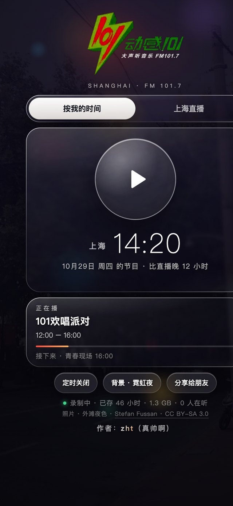
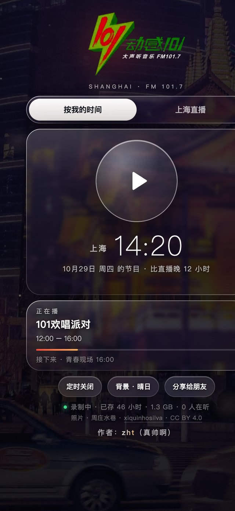
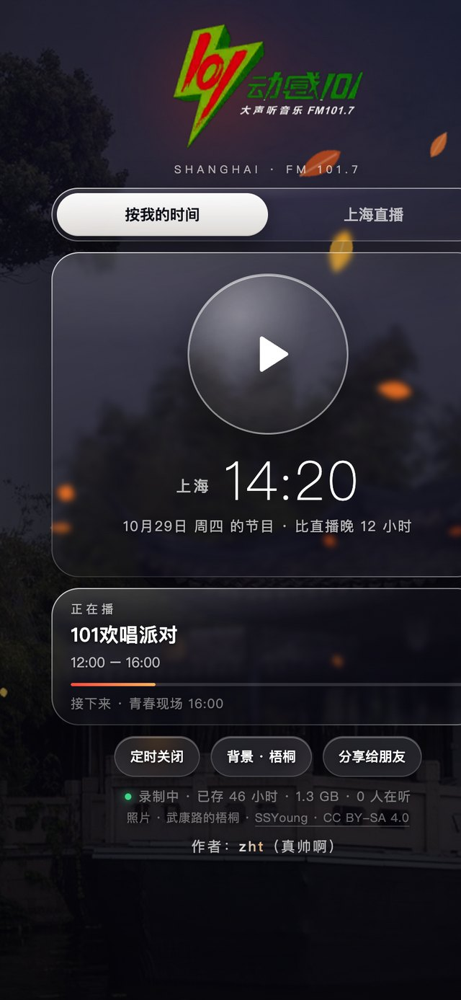

# 动感101 time-shift radio

[中文](README.md) · English

> Open it at 7 am in New York and you hear what Shanghai's 动感101 (FM 101.7) played at 7 am Shanghai time.
> Time zones are not recognised on these premises.

<p align="center">
  
  
  
</p>

> **Can't be bothered to host it? Just use mine:**
> **https://159-203-11-150.sslip.io/n9o7y7779rr9/**
>
> Open it in Safari, "Share → Add to Home Screen" and treat it as an app. "My time" follows your phone's
> time zone, so New York, Vancouver and London each get their own 7 am; east of Shanghai you simply get the
> live stream. It runs on a $4/month box, a few dozen listeners are fine, and if it ever gets crowded I'll upgrade.

## Why this exists

I grew up in Kunshan, just outside Shanghai. Every school run, there and back, my mum's car radio was on
FM 101.7. I can't tell you which shows were on; the engine started and so did 动感101, and changing the
station was not a thing. After enough years of that, the frequency is probably in my DNA.

Then I moved abroad. A few years later I'm in New York and my taste hasn't moved an inch. The problem:

- Online there is only the **live** stream.
- At 7 am in New York it is 7 pm in Shanghai. I want the bright, loud morning-commute station; I get the
  gentle after-work evening show.
- Want to hear the school-run programme at school-run o'clock? Set an alarm for 3 am.

The station is not going to change its schedule for me, so the server does it instead: record Shanghai,
wait twelve hours, play it back at the same wall-clock time. My mum's car, relocated to New York.
And, while we're at it, every other homesick 101 listener on the planet. If there are any.

## How it works

No magic, just "record now, play later":

- A cheap little server pulls the live stream around the clock, stores it as one-minute MP3 chunks and keeps
  the last 48 hours.
- Your phone sends its time zone. The server works out the moment where "Shanghai clock = your clock",
  starts streaming from there at real-time pace, and keeps going with the screen locked.
- New York is 12 or 13 hours behind Shanghai, so the part you want is always already recorded. East of
  Shanghai there is nothing to shift to, and the page honestly falls back to live and says so.
- One Python file, standard library only: no ffmpeg, no database, no pip install, about 20MB of RAM. At heart
  it copies bytes from the network into files and back out again.

## What you get

- "My time / Shanghai live" toggle, for the nights you miss Shanghai's nights.
- Now-playing card with host, progress and what's next (weekday schedule from Qingting FM; weekends may differ).
- −30s / start of show / +30s in shifted mode; lock-screen seek buttons work and the lock screen shows
  "which Shanghai hour" you're hearing.
- Sleep timer (15 / 30 / 60 / 90 min), share sheet, and a listener count that is usually 1.
- Backgrounds: 30 freely licensed photos of Shanghai and Kunshan from Wikimedia Commons (the Bund, Lujiazui,
  Yu Garden, Zhujiajiao, Wukang Road, and of course Zhouzhuang and Qiandeng), credits on the page and in
  `photos/CREDITS.md`, with weather on top: neon bokeh, fireflies, sun motes, rain and lightning, cherry
  petals, falling leaves, snow, plus a WebGL aurora. Random shuffle every 30 seconds, or pin a scene.
- Clear-glass cards. After 7 seconds of untouched playback the UI fades out so the photo shows through; one
  tap brings it back.

## Run your own

If you would rather not, the link above is yours to use.

### On a server (recommended)

1. Create a small Ubuntu 24.04 server (the cheapest DigitalOcean droplet, $4/month, 512MB, is enough).
2. Authenticate with an SSH key. The script uses `~/.ssh/radio1017_ed25519` by default; create one with
   `ssh-keygen -t ed25519 -f ~/.ssh/radio1017_ed25519` and paste the `.pub` into the provider's console, or point
   it elsewhere with `RADIO_SSH_KEY=~/.ssh/id_ed25519 ./deploy.sh ...`.
3. From this folder:

```bash
./deploy.sh <server-ip> America/New_York
```

The second argument is the time zone used for "my time". The script installs a systemd service and Caddy, gets
an https certificate automatically, opens the firewall and prints the URL for your phone, like
`https://1-2-3-4.sslip.io/key/`. The random key in the path keeps strangers out. Re-run the same command after
changing the code; the key stays. Pass a third argument to rotate it. Open the URL in Safari and
"Share → Add to Home Screen".

### On a Mac

`./install.sh` installs a launchd background service (program and recordings under
`~/Library/Application Support/radio1017`) and prints the LAN URL. `./uninstall.sh` removes it
(`--purge` also deletes recordings). Or just run `python3 radio1017.py` and open http://localhost:8017.
Environment variables: `RADIO_PORT`, `RADIO_BIND`, `RADIO_KEY` (path prefix), `RADIO_LOCAL_TZ`, `RADIO_DATA`.

## Another station

Not a Shanghai kid? `STREAMS` at the top of `radio1017.py` is the stream URL, `STATION_TZ` the station's time
zone, `SCHEDULE` in the page is the programme guide, and `LOGO_B64` / `ICON_B64` hold the logo. Change those
and you can hear your own hometown station at the right hour from the other side of the planet.

## License

Code: MIT. Photos belong to their photographers on Wikimedia Commons; individual CC licenses and credits are in
`photos/CREDITS.md`. The 动感101 logo and programmes belong to Shanghai Media Group; this is a personal,
non-commercial listening tool and is not affiliated with the station. If anyone from the station reads this:
thank you for the soundtrack.

## Finally

If this reminds you of a particular morning in a particular car, leave a star so I know I'm not the only one.

Author: zht
